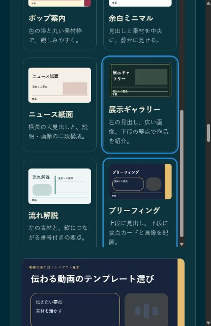
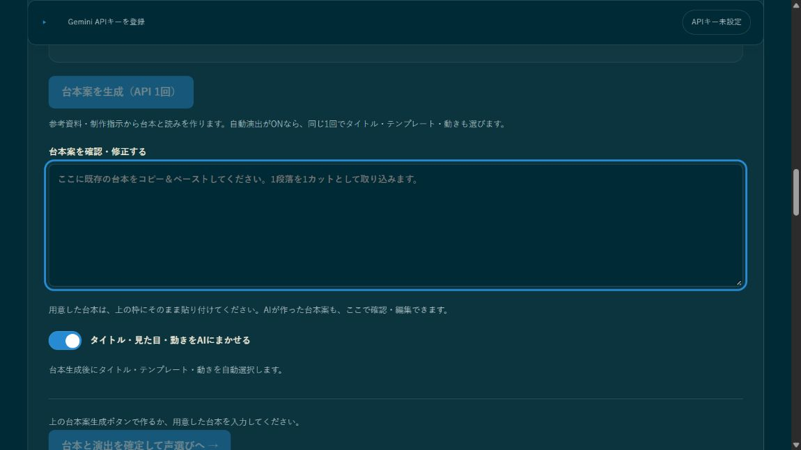
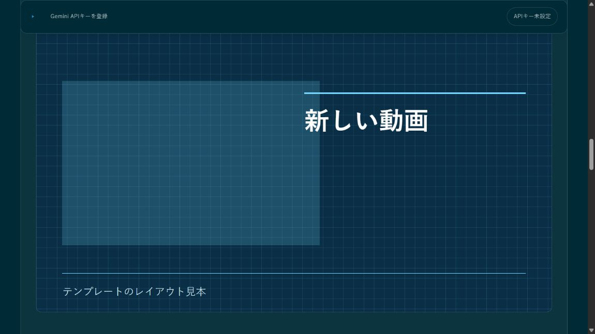
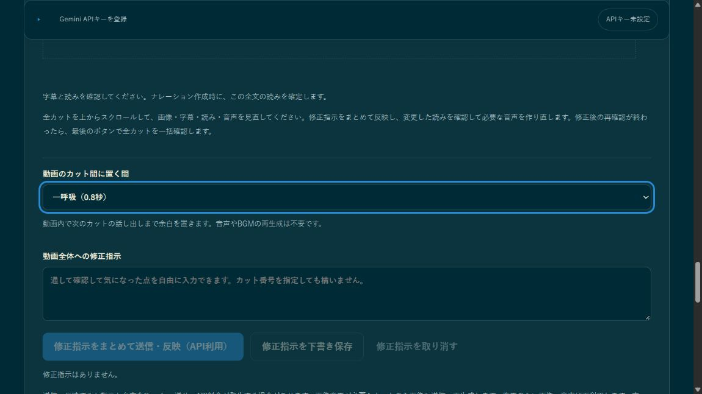
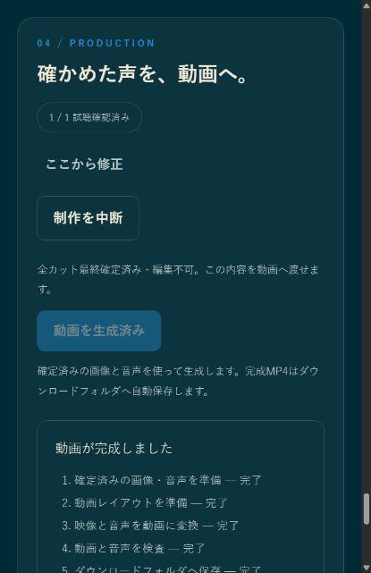

# Gemini Narration Studio / Gemini ナレーション・スタジオ v1.2.3

A Windows x64 local app for turning materials and scripts into narrated, subtitled MP4 videos. Review Japanese readings, create Gemini speech, check each cut's image and audio, then export locally. Distribution currently uses a private GitHub repository; access requires an invitation.

素材・台本から、読みの確認、Gemini音声、カットごとの画像と音声の見直し、字幕付きMP4の保存までを行うWindows x64用ローカルアプリです。現在は非公開GitHubで配布しており、アクセスには招待が必要です。

## Start / 起動する

1. Download **Source code (zip)** from the [latest Release](https://github.com/FURUYAN1234/gemini-narration-studio/releases/latest) and extract the whole ZIP to a writable folder. / [最新Release](https://github.com/FURUYAN1234/gemini-narration-studio/releases/latest)の **Source code (zip)** を書き込み可能なフォルダーへすべて展開します。
2. Double-click `start_narration_studio.bat`. It reuses Node.js 22+ and npm, or installs official Node.js 22.23.3 into your user folder when needed. No administrator rights or system PATH changes are required. / バッチをダブルクリックします。Node.js 22以上とnpmは再利用し、不足時は公式のNode.js 22.23.3を利用者専用フォルダーへ導入します。管理者権限やシステムPATHの変更は不要です。
3. Missing Remotion/React dependencies and the rendering browser are downloaded. The app opens at `http://127.0.0.1:6181/`. Initial setup needs internet access and may take several minutes. / 動画処理ライブラリと描画ブラウザーを不足時に取得して画面を開きます。初回は接続が必要で、数分かかる場合があります。
4. Enter your Gemini API key at the top before using Google services. The key stays in server memory and is never saved to disk. / Googleを使う処理の前に画面上部へGemini APIキーを入力します。キーは起動中のメモリだけに保持し、ファイルへ保存しません。

Keep the terminal window open while using the app; Ctrl+C exits. The maintained copy on the author's PC is `C:\gemini-narration-studio-main`; other users can run the extracted ZIP from any writable folder. A studio already serving the same production folder is reused. Unrelated apps and studios using other data are not stopped.

利用中は黒いウィンドウを開いたままにし、終了時はCtrl+Cを押します。開発元PCの正式コピーは `C:\gemini-narration-studio-main` です。利用者は任意の書き込み可能な場所から起動できます。同じ制作データのスタジオが起動済みなら再利用し、他のアプリや別データのプロセスは停止しません。

Production data lives in `%USERPROFILE%\GeminiNarrationStudio`; finished MP4s go to Windows Downloads. App updates do not replace production data. A custom location can be set with `start_narration_studio.bat --output "D:\Video"`.

制作データは `%USERPROFILE%\GeminiNarrationStudio`、完成MP4はWindowsの「ダウンロード」に保存します。本体の更新で制作データを置き換えません。別の保存場所は `start_narration_studio.bat --output "D:\動画制作"` のように指定できます。

### Setup and troubleshooting / 初回準備とトラブル対応

Portable Node.js is stored under `%LOCALAPPDATA%\GeminiNarrationStudio\runtime`; rendering dependencies and the browser live in `node_modules`. Node.js ZIPs must match the SHA-256 from the [official distribution](https://nodejs.org/dist/v22.23.3/) before extraction. Git, Python, VOICEVOX and Hugging Face are not required. Read terminal errors and fix connectivity or folder permissions before retrying; consult your administrator for company restrictions. Do not bypass Windows warnings blindly. `--setup-only` performs setup without opening the studio.

Node.jsは利用者専用のruntimeフォルダー、動画処理ライブラリと描画ブラウザーは `node_modules` に保存します。ZIPは[公式配布](https://nodejs.org/dist/v22.23.3/)のSHA-256と照合し、不一致なら展開・実行しません。Git・Python・VOICEVOX・Hugging Faceは不要です。エラーでは黒いウィンドウの理由を確認し、接続やフォルダーの権限を直してください。企業PCの制限は管理者へ相談し、Windowsの警告を無条件に解除しないでください。準備だけなら `--setup-only` を使えます。

## Templates / 動画テンプレート

Compare twelve layouts below the materials/script section. The four additions adapt layout, spacing and color principles from [Hallmark](https://github.com/Nutlope/hallmark) for subtitled 16:9 video.

素材と台本の下で12種類の見本を比較できます。新しい4種類には[Hallmark](https://github.com/Nutlope/hallmark)の構成・余白・色の統一という考え方を、字幕のある16:9動画向けに取り入れました。

| Template / テンプレート | Composition / 構成 |
|---|---|
| Broadsheet / ニュース紙面 | Wide headline with explanation and image below. / 横長の大見出しと下段の説明・画像。 |
| Gallery / 展示ギャラリー | Large artwork and supporting points. / 広い画像と下段の要点。 |
| Flow / 流れ解説 | Artwork beside a vertical numbered sequence. / 素材の横に番号付き要点を縦に配置。 |
| Briefing / ブリーフィング | Heading above point cards and artwork. / 上段の見出しと下段の要点カード・画像。 |

Select a preview; moving to the next step saves the design. Comparing/selecting templates uses no generation API. New layouts retain their structure during motion rendering and reveal points over time. Existing readings/audio remain available. Sealed projects allow preview browsing; create a separate revision to change the finished video.

見本を選ぶと、次のSTEPへ進む際に保存します。比較・選択では生成APIを使いません。新しい構成は動きを有効にしても維持され、要点を順に表示します。保存済みの読み・音声は再利用できます。最終確定済みの制作では見本の比較だけが可能で、動画を変更するには修正版を作ります。

## Materials and planning / 素材と構成案

Add images, PDF, UTF-8 TXT, audio, video, reference text or public URLs, then describe the video. Planning sends these inputs and instructions to Gemini 3.5 Flash once: up to 12 MB and 20 files combined, plus 10 URLs. URL Context must report successful retrieval before a plan is accepted. Login-only pages and recursive crawling are unsupported. Failures do not automatically retry or delete existing scripts/audio.

画像・PDF・UTF-8 TXT・音声・動画、参考本文、公開URLを追加します。資料があれば制作指示は空欄でも使えます。構成作成では入力と指示をGemini 3.5 Flashへ1回送信します。合計12MB・20ファイル、URL10件までです。URL Contextの取得成功記録がなければ構成案を適用しません。ログインが必要なページやリンク先の自動探索には対応せず、自動再試行や既存台本・音声の削除も行いません。

The plan includes captions, hiragana readings, headings, points, source attribution, image assignments/focus and title/voice proposals. Choose automatic or manual title/voice selection; titles remain editable. Check source summaries and each cut's references. Each cut also has a context, detail or summary purpose and a shared visual-style proposal carried into planned image prompts. These explanatory-video principles draw on [Director Skills](https://github.com/kangarooking/director-skills). Timing follows actual synthesized speech. Planning does not generate images, synthesize speech or approve the final video. Older saved projects remain readable. Generate a draft above the script editor, review/edit it, or explicitly regenerate below it. Automatic direction is ON for new projects: the same drafting request returns a title, one of the twelve validated templates and motion settings, with a layout thumbnail. Switching OFF opens manual adjustments; apply and close them without a provider call. The final STEP01 button saves the script and direction and proceeds to voice selection. Existing scripts can be used; missing readings/direction are disclosed as one preparation request. Regenerated scripts replace the accepted cuts without duplication and reuse exactly unchanged speech audio. A URL-only entry in the script box is treated as a reference, never as narration.

字幕・ひらがなの読み・見出し・要点・出典・画像の割り当てと注目位置・タイトル・声を提案します。タイトルと声は自動／手動を選べ、タイトルは手修正できます。資料要約と各カットの出典を確認してください。各カットに全体像・詳細・要約の役割と共通の視覚方針を提案し、配色・外見・図の表記を生成予定の画像指示へ反映します。[Director Skills](https://github.com/kangarooking/director-skills)の素材分析・分鏡・一貫性の考え方を解説動画に合わせています。時間は実音声に合わせます。構成作成は画像・音声の生成や最終確認を代行せず、既存の制作も開けます。台本欄の上で案を生成し、確認・修正後、必要なら下のボタンで明示的に再生成します。新規制作は自動演出がONで、同じ台本生成の1回でタイトル・12種からのテンプレート選択・動きを返し、見本を表示します。OFFで手動調整を開き、「調整を反映して閉じる」でAPIなしで保存できます。01末尾のボタンは台本と演出を保存して声選びへ進みます。既存台本も使え、読みや自動演出が未準備なら1回の準備処理を明示します。再生成した台本はカットを重複させず取り込み、同じ字幕・読みの音声は保持します。台本欄にURLだけを貼った場合も、読み上げ用の文章ではなく参考資料として扱います。

### Supplied and generated artwork / 提供画像と生成画像

Provided-only mode prohibits image generation. Mixed mode selects relevant images and proposes generation only for missing artwork; not every reference needs to appear. Review a cut's instructions and up to three reference images before explicitly generating one image with Gemini. Image-only changes reuse unchanged script/audio. Failures preserve completed assets without retrying automatically. Image focus can zoom toward a labeled area; replacing artwork clears its old focus. Check names and explanations too. Headings/points are editable without an API call. These controls do not generate new actions for pictured people or remove backgrounds.

提供素材のみでは画像を生成しません。混合モードは関連する画像を選び、不足したカットに生成案を用意します。資料をすべて映す必要はありません。指示と参照画像（最大3枚）を確認して、明示操作で1枚ずつ生成します。画像だけの変更は台本・音声を再利用し、失敗時も完成済み素材を残して自動再試行しません。注目位置とラベルで指定箇所へ寄れます。差し替え時は古い注目位置を解除するので、人物名や説明も確認してください。見出し・要点はAPIなしで編集できます。人物の新しい動作や背景除去は生成しません。

### Script input / 台本入力

Choose an AI draft, manual input/paste, or an AI rewrite of the current script. Manual mode hides the AI instructions and sending controls. A reference alone or a theme is enough for a new draft; choose “Let AI choose the theme” explicitly to leave both unspecified. The result field accepts corrections, editing, clearing, new typing and pasting. Saving a draft and adopting it for the next step use no generation API. In step 3, enter missing readings yourself or explicitly prepare them with one API request, then confirm the readings before creating audio. A rejected optional image or presentation proposal does not discard validated narration. Requests and validated results are saved on the server; an unsaved-result warning offers a local save retry without another generation.

AIで新しく作る、自分で入力・貼り付ける、入力した台本をAIで整える、のいずれかを選びます。手入力ではAI指示欄と送信操作を隠します。新規AI作成は資料だけ・テーマだけでも可能で、何も指定しない場合は「テーマからAIに任せる」を明示して選びます。結果欄で修正・編集・全削除・新規手入力・貼り付けができます。入力・下書き保存・「この台本を採用して声選びへ」では生成APIを使いません。①の編集本文が採用済みカットを置き換え、同じ台本を二度採用しても追記しません。読みが未準備なら③で手入力するか、「未確認の読みをAIで準備（API 1回）」を選び、確認後に読みを確定して音声を作ります。画像・演出案だけが条件に合わない場合も、有効な台本を保持して未適用の項目を表示します。入力と検証済み結果はサーバーに保存し、保存失敗時は未保存の結果を表示して、追加生成なしで保存し直せます。

## Voice and reading review / 声と読みの確認

Prepare written captions and corresponding hiragana pronunciation, then choose the voice and pitch. The app bundles 180 samples: 30 voices across two models and three pitch settings. Comparison uses no API request. Pitch is a speaking-style instruction, not a precise semitone adjustment. Review each cut's image, caption and reading in STEP03, then use the narration action. It creates missing speech and optional BGM and advances to STEP04 for listening and video generation. It never records listening, seals the project or renders automatically; final confirmation follows actual review. Corrections may use the API and regenerate only affected assets. Local hints do not prove correct pronunciation. Final confirmation seals the reviewed inputs and renders locally.

通常表記の字幕と対応するひらがなの読みを整え、声とピッチを選びます。全30声×2モデル×3ピッチの180サンプルを同梱し、比較ではAPIを使いません。ピッチは話し方への指示で、正確な半音指定ではありません。③で画像・字幕・読みを見直し、ナレーション作成で必要な音声と任意のBGMを作って④の試聴・動画生成へ進みます。試聴済みの記録・最終確定・動画生成は自動で行いません。実音声とBGMを確認後、「確認して動画を生成」を押してください。修正はAPIを使う場合があり、必要な素材だけを作り直します。確認候補の表示は読みの正解を保証しません。最終確認で内容を固定してローカルで描画します。

### Using Codex / Codexから使う

The personal `gemini-video-narration` Skill reuses an existing session or starts `node C:\gemini-narration-studio-main\launch.mjs --no-browser` in the Codex in-app browser. Ordinary local use shares the same scripts, audio and materials. Enter keys in the app, never in chat. Work can be paused, and earlier stages can create separate revisions while retaining completed originals.

個人Skill `gemini-video-narration` は既存セッションを再利用し、必要時にアプリを起動してCodex内ブラウザーへ表示します。通常起動と同じ台本・音声・素材を使います。キーはチャットへ渡さずアプリに入力してください。制作の中断や前工程からの修正版作成ができ、元の完成済み制作は残ります。

## Motion / 画面の動き

Headings wrap at Japanese and English word boundaries and adjust font size to fit the available area without omitting text.

見出しは日本語・英語の語の区切りで改行し、全文を省略せず、表示領域に合わせて文字サイズを調整します。

Choose cinema (zoom/depth), typography (large text/transitions), editorial (lines/points) or quiet slides, with gentle, standard or bold motion. Moving to the next step saves the choice. New projects start with cinema; old projects retain their previous display until changed. Selected colors are reused, and the four new templates preserve their structure. Backgrounds, images and text animate locally without speech/image regeneration, extra models or external animation services. This does not create people's actions or 3D geometry. The silent preview supports play/pause and reduced-motion preferences; it is not the final video. Subtitle/point timing is estimated from speech pauses and reading length. AI designs may propose colors, placement and motion; an explicitly saved quiet-slide choice remains in force. Sealed videos require a revision for changes.

シネマ（寄りと奥行き）、タイポグラフィ（大きな文字と展開）、図解（線と要点）、静かなスライドから選び、控えめ・標準・大きくの強さを選び、次のSTEPへ進む際に保存します。新規制作はシネマ、既存制作は変更するまで従来の表示です。配色を引き継ぎ、新しい4種類は構成を維持します。背景・画像・文字をこのPCで動かし、演出変更だけでは音声・画像を再生成せず、追加モデルや外部の動画サービスも使いません。人物の動作や3D形状の生成は含みません。見本は音声なしの簡易表示で再生・停止と動きを減らす設定に対応し、完成動画そのものではありません。字幕・要点の時間は音声の間と読みの長さからの推定です。AIデザインは配色・配置・動きを提案できますが、保存した静かなスライド設定は維持します。確定済み動画の変更には修正版を使います。

Cut transitions offer 13 families / 35 shape and direction variants. AI can propose the sequence and its surfaces in the existing script/design request: the next cut's image or the chosen background, accent or heading color. Local rendering avoids repeated solid tones, keeps images aligned through tile/clock effects, reserves subtitle space and preserves speech timing. Older plans vary images and palette colors without an extra API call. Quiet slides disable these effects; short cuts suppress them. Finished videos remain unchanged until a separate revision is rendered.

カットの切替は13系統・方向や形の違いを含めて35種類です。AIが既存の台本・デザイン設計の応答で、内容や繰り返しを考慮し、次のカットの実画像・背景色・アクセント色・文字色から切替案を選べます。描画時に同じ単色の連続を避け、タイルや時計形でも画像の向きと位置を保ち、字幕領域と音声の時間を変えません。旧データも追加のAPI呼び出しなしで画像と配色を使い分けます。「静かなスライド」では無効、短いカットでは抑制します。完成済み動画は修正版を別途生成するまで変わりません。

## Music, title and credits / BGM・タイトル・クレジット

New projects enable BGM by default. Set the cut pause after cut review and before overall correction instructions; the BGM switch remains above narration creation. The narration button first creates speech, then requests one Lyria 3.5 track if BGM is enabled and missing or stale. Switching BGM alone makes no generation request; OFF preserves the saved track and excludes it from the video. Style instructions are optional; the prompt asks for instrumental music, but listen to verify no vocals. Your key needs Lyria access. Choose a level or remove music. The renderer crossfades short tracks, ducks during speech and fades at the beginning/end; long tracks end with the video. Errors do not switch services or automatically retry. Script/audio changes make old music unconfirmed; review and reuse with the no-API action where applicable, or create a revision after sealing. New cut pauses default to 0.8 seconds; older projects retain their saved duration. Pause/level changes do not regenerate speech/music. Existing BGM appears before folded recreation controls.

新規制作はBGMがONです。カット確認の後、全体への修正指示の前にカット間の余白を設定します。BGMスイッチはナレーション作成の上にあります。作成ボタンで音声を作り、ONでBGMが未作成・変更済みなら、続けてLyria 3.5を1回使います。切替だけでは生成せず、OFFでは保存済みの曲を保持して動画から外します。曲調は任意指定で、空欄なら自動です。歌なしを指示しますが、実際に歌声がないことは試聴して確認してください。Lyriaの利用権限が必要です。音量を選ぶかBGMなしに戻せます。短い曲はクロスフェードでつなぎ、ナレーション中に減音し、開始・終了をフェードします。長い曲は動画尺で終わります。他社切り替えや自動再課金はありません。台本・音声が変わると古いBGMでの確定を止め、確認後にAPIなしで再利用するか、確定済みなら修正版を作ります。カット間は新規制作で0.8秒、既存では保存値を維持し、余白・音量変更では再生成しません。作成済みBGMを先に表示し、再作成は下に折りたたみます。

The opening-title/ending section stores title text, its hiragana reading, ending name, URL, author and duration without an API call. Approve the title's reading and synthesize only that speech; body audio is reused. Ending credits align subtly lower-right. The author mark uses `@creation-year/author`; the saved year remains unchanged on later exports/revisions. Recheck title audio, credits and any BGM reuse before sealing.

冒頭タイトル・エンドクレジット欄では表示タイトル・ひらがなの読み・EDの名前とURL・作者名・表示秒数をAPIなしで保存できます。タイトルの読みを確認してその音声だけを作り、本編の音声は再利用します。EDは右下に控えめに表示し、作者マークは `@作成年/作者名` です。保存した年は翌年の再出力・修正版でも変わりません。タイトル音声・クレジット・BGMの再利用を確認してから確定します。

## Export and saved projects / 出力と保存した制作

AI proposes which supplied images to use and which missing images to create. Approve the proposal and its generation count to prepare the cuts. Replanning or replacing an individual image is optional; unchanged script and audio are retained. File selection, drag-and-drop, unassignment and removal from the material list are available inside the image adjustment controls. Removed material files remain on disk.

AIが提供画像の割り当てと不足画像の作成を提案します。内容と新規作成枚数を確認して承認すれば、カットの画像を準備できます。再提案・再生成・手動差し替えは気になるときだけ使い、変更しない台本と音声は保持します。画像の調整欄でファイル選択・ドロップ・割り当て解除ができ、素材一覧からも外せます。元の素材ファイルは残ります。

Once narration is ready, the full-length player appears automatically as one seekable audio track, including cut pauses. The explicit narration submission button replaces the separate consent checkbox; voice selection and reading confirmation are still required.

音声がそろうと、カット間の余白を含む一本の全文プレーヤーを表示します。再生位置は自由に移動できます。音声生成は送信内容を明記したボタンで実行し、別の同意チェックは不要です。声の決定と読みの確認は引き続き必要です。

Final confirmation prepares the exact reviewed assets, renders the video, checks streams and full decoding, and saves uniquely named MP4 and standalone M4A files to Downloads with matching hashes. The M4A contains the same narration and BGM as the video. The finished player and both download links appear after success. “別の制作を始める” starts an empty project and returns to the top; it does not render a video. Reopen earlier work from the saved-project menu. Unsaved edits and active processing block switching; the key remains in memory until server exit and completed originals are preserved.

最終確認後、確定素材を用意して描画し、映像・音声情報と全デコードを検査します。ハッシュ一致を確認し、固有名のMP4と単独音声M4Aを両方ダウンロードへ自動保存します。M4Aには動画と同じナレーション・BGMが入ります。成功後は完成プレーヤーと両ファイルの保存リンクを表示します。「別の制作を始める」は空の制作を始めて先頭へ戻る操作で、動画生成とは別です。以前の制作は保存メニューから開きます。未保存の編集・処理中は切り替えを止め、キーは終了までメモリに保持し、完成済みの元作品は残します。

## Distribution and backup / 配布とバックアップ

GitHub Pages is disabled. Release ZIPs contain the app, third-party notices, standard samples and documentation screenshots, excluding credentials and personal scripts/artwork/audio/videos. Antigravity full backup includes this app's Git recovery data, C-drive version evidence and safe files in the default production folder. Backup is a separate operation, not triggered by deployment. Custom `--output` folders need separate backup coverage. Keys must be entered again after restoration.

GitHub Pagesは無効です。配布ZIPにはアプリ・第三者の案内・標準サンプル・説明用キャプチャを含め、認証情報や個人の台本・制作画像・音声・動画は含めません。AntigravityフルバックアップにGit復旧情報、Cドライブ版の証拠、既定の制作フォルダー内の安全なファイルを登録しています。バックアップはデプロイとは別操作です。別の `--output` は別途対象にする必要があり、復元後はキーを再入力します。

Use `npm ci`, `npm test` and `npm run build` for development. Copy shared-runtime updates using the root `scripts/sync_narration_distribution.mjs`, validate, bump the version and use the established release transaction. Read [third-party terms](THIRD_PARTY_NOTICES.md). The app itself currently has no open-source license; repository visibility does not change third-party obligations.

開発時は `npm ci`・`npm test`・`npm run build` を使います。共有Runtimeの更新はルートの同期スクリプトで配布版へ反映し、検査・バージョン更新後に正式な配布手順を実行します。[第三者の条件](THIRD_PARTY_NOTICES.md)を確認してください。本体にオープンソースライセンスは現在設定しておらず、公開設定で第三者条件が変わることもありません。

## API use and publication / API利用と公開

Planning, corrections, speech, image and music generation send data to Google and may incur charges; review disclosed inputs and request counts. Keys are not saved, but materials/scripts/generated work remain in the production folder. Check rights and personal information before sending. Cached samples, local motion and MP4 assembly do not call a generation API. The [article draft](docs/note-draft.md) and [publication checklist](docs/publication.md) describe future public delivery. Saving a draft here does not publish it on note or social media.

構成・修正・音声・画像・BGM生成ではGoogleへの送信とAPI料金が発生する場合があるため、画面の対象・回数を確認してください。キーは保存しませんが、素材・台本・生成物は制作フォルダーへ保存します。送信前に権利と個人情報を確認してください。保存済みサンプル・ローカル演出・MP4組み立てでは生成APIを使いません。[note記事原稿](docs/note-draft.md)と[公開準備](docs/publication.md)は今後の一般公開用です。原稿の保存はnoteやSNSへの投稿・公開ではありません。
