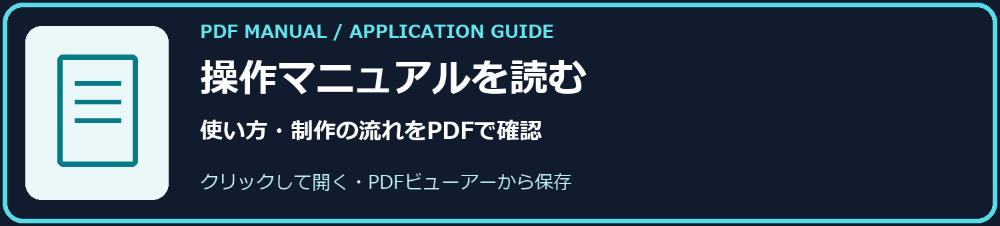
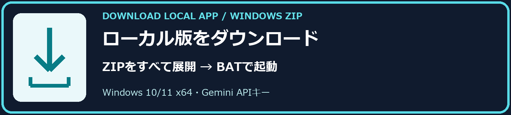
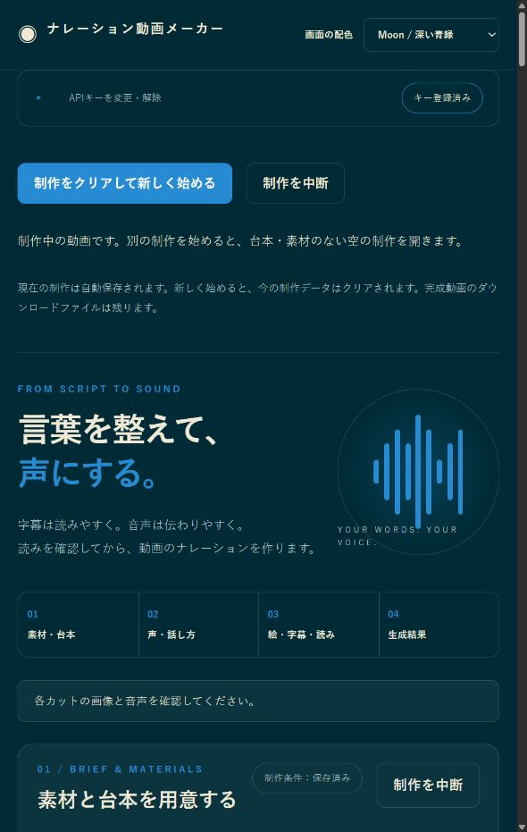
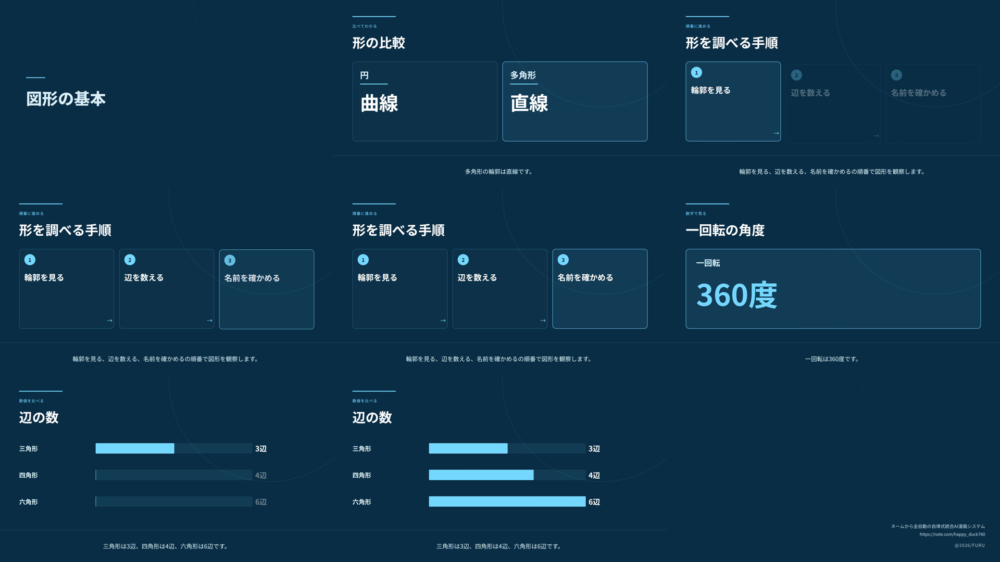
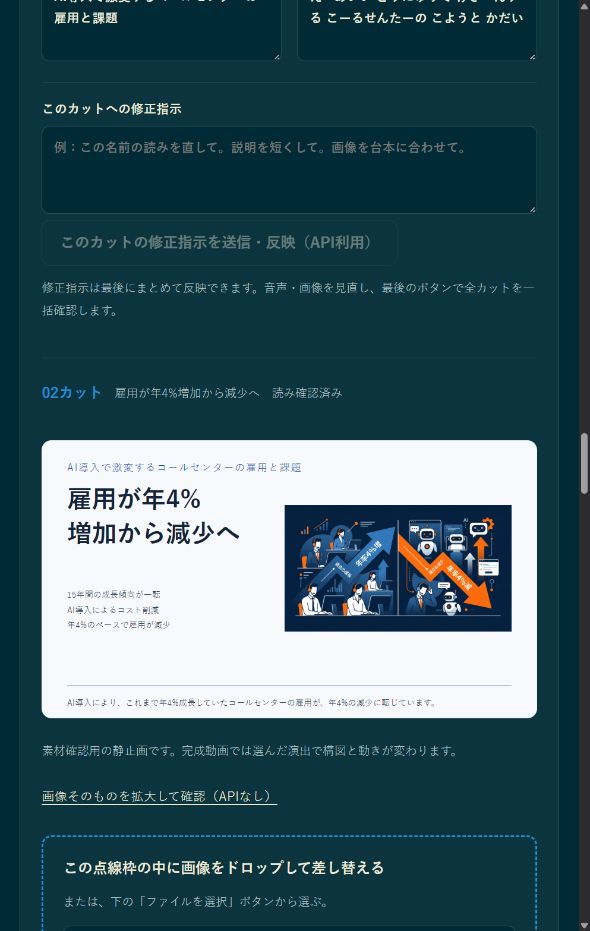

[](https://furuyan1234.github.io/gemini-narration-studio/narration-guide.pdf) [](https://furuyan1234.github.io/gemini-narration-studio/narration-api-guide.pdf)

[](https://furuyan1234.github.io/gemini-narration-studio/narration-guide.pdf)

Operation guide / 操作ガイド: Open the PDF to review the application workflow and controls. / PDFで制作の流れと操作方法を確認できます。

Read both Japanese A4 guides from the app header or the public installation page. / 日本語A4の操作・API設定ガイドは、アプリ上部と公開導入ページから別タブで開けます。

# Narrated Video Maker / ナレーション動画メーカー v1.3.5

> **MIT License; your outputs remain yours.** You may use, modify, redistribute and sell the app, including in paid products and services, without individual permission from FURU. Retain the copyright and MIT license notices in copies or substantial portions of the software. External API fees and third-party terms are separate. / **アプリはMITライセンス。成果物の権利は従来どおり利用者に帰属します。** アプリの利用・改変・再配布・販売、有料商品やサービスへの組み込みに、FURUへの個別許可は不要です。ソフトウェアの複製または重要な部分には著作権表示とMITの許諾表示を残してください。外部API料金と第三者の条件は別です。

[](https://furuyan1234.github.io/gemini-narration-studio/)

[](https://github.com/FURUYAN1234/gemini-narration-studio/archive/refs/heads/main.zip)

**Local app ZIP / ローカルアプリZIP:** Download and extract the entire ZIP, then double-click `start_narration_studio.bat` on Windows. Windows 10/11 x64, internet access and your own Gemini API key are required. The launcher prepares missing Node.js/npm. Internet access and the selected provider's API key are required for AI API features; API charges are separate. / ZIP全体をダウンロードしてすべて展開し、Windowsで `start_narration_studio.bat` をダブルクリックします。Windows 10/11 x64・Gemini APIキー。AIのAPI機能にはインターネット接続と利用する事業者のAPIキーが必要で、API利用料金は別途かかります。

The public website is an installation guide. Run the batch file on your PC to create narration and videos. / 公開サイトは導入案内です。ナレーション・動画の制作はPC上でバッチを起動して行います。


Public installation guide / 導入・配布ページ: [https://furuyan1234.github.io/gemini-narration-studio/](https://furuyan1234.github.io/gemini-narration-studio/)

Turn reference materials and scripts into 16:9 videos with Japanese narration, captions, pictures, motion and automatic BGM on Windows. / 参考資料と台本から、日本語ナレーション、字幕、画像、動き、自動BGMのある16:9動画をWindowsで作ります。

[Download the latest release / 最新版をダウンロード](https://github.com/FURUYAN1234/gemini-narration-studio/releases/latest) · [Public installation guide / 公開導入ページ](https://furuyan1234.github.io/gemini-narration-studio/) · [Japanese beginner PDF / はじめての方向けPDF](docs/narration-guide.pdf)

Use **使い方マニュアル（PDF）** in the app header to read the bundled guide in a separate tab and save it from the PDF viewer. / アプリ上部の **使い方マニュアル（PDF）** から別タブで読めます。保存はPDFビューアーから行えます。ネット接続やAPIキーは不要です。



## Explain with pictures and diagrams / 画像と図解で伝える

Create product introductions, activity reports and lessons from your own materials. Pictures can accompany explanatory layouts. / 手持ちの写真や文章から、商品紹介、活動報告、学習用の解説を作れます。写真と図解を組み合わせることもできます。

| Diagram / 図解 | Example / 使い方の例 |
| --- | --- |
| Comparison / 比較 | Put two characteristics side by side, such as curved and straight outlines. / 円の「曲線」と多角形の「直線」を並べて説明します。 |
| Steps / 手順 | Reveal an ordered process as narration progresses. / 「輪郭を見る→辺を数える→名前を確かめる」を順に見せます。 |
| Highlighted number / 数字強調 | Give a key number a clear visual focus. / 「一回転は360度」の360度を大きく表示します。 |
| Bar chart / 棒グラフ | Compare quantities that share one unit. / 三角形3辺・四角形4辺・六角形6辺を長さで比較します。 |



These frames come from a 32-second narrated video created through the app from a short mathematics reference text, without image generation. / 上の画像は、短い算数の参考本文からアプリで作成した約32秒のナレーション動画です。画像生成を使わず、4種類の図解を使っています。

**Use diagrams suited to the content (recommended)** is on for a new production. Leave it on when asking AI to plan from materials, then review each cut's diagram, caption and reading. AI selects diagrams only where suitable; not every cut needs one. / 新しく作るときは **内容に合わせた図解を使う（おすすめ）** がONです。参考資料からAIで台本を作り、カットごとの図解・字幕・読みを確認します。内容に適した場面で図解が選ばれ、すべてのカットに付くとは限りません。

Diagram-only cuts do not require pictures. Turning the diagram switch off uses the ordinary layout; this switch alone makes no generation request. Diagram text and numbers are checked against the current caption. Check the original source yourself. Reveals use estimated subtitle timing, not exact word alignment. / 図解だけのカットは画像なしでも作れます。OFFなら通常のレイアウトになり、切り替えだけでは生成APIを呼びません。図解の文字や数値は現在の字幕と照合しますが、資料自体の正しさは利用者が確認してください。表示は推定した字幕タイミングに合わせるため、単語単位の厳密な同期ではありません。

## Requirements / 用意するもの

Use Windows 10 or 11, x64, a writable local folder, an internet connection and your own Gemini API key. ARM and macOS are unverified. / Windows 10または11のx64版、書き込み可能な保存場所、インターネット接続、ご自身のGemini APIキーを用意してください。ARM版とmacOSは動作未確認です。

The public website is a download and installation guide. Video processing runs on your PC after launching the batch file. Git, Python and a separately installed voice engine are unnecessary. / 公開サイトはダウンロードと導入案内です。動画処理はバッチで起動したPC上で行います。Git、Python、別の音声エンジンの導入は不要です。

## Download and launch / ダウンロードとバッチ起動

1. Open the latest Release above. Under Assets, choose **Source code (zip)**. / 上の最新版ダウンロードを開き、Assets欄の **Source code (zip)** をクリックします。
2. In Windows Downloads, right-click the ZIP and choose **Extract All**. Do not run files inside the ZIP. / WindowsのダウンロードでZIPを右クリックし、**すべて展開**を選びます。ZIP内のまま起動しないでください。
3. Move the extracted folder to a writable location, for example `C:\VideoTools\gemini-narration-studio`. Open the inner folder containing `package.json`. / 展開したフォルダーを、たとえば `C:\VideoTools\gemini-narration-studio` に移します。`package.json` がある内側のフォルダーを開きます。
4. Double-click **start_narration_studio.bat**. If extensions are hidden, it may appear as **start_narration_studio**, with type Windows Batch File. / **start_narration_studio.bat** をダブルクリックします。拡張子が非表示なら **start_narration_studio** と表示され、種類はWindowsバッチファイルです。
5. Keep the black terminal window open. The first launch prepares missing Node.js/npm, video libraries and the rendering browser; wait for completion. / 黒いウィンドウを開いたままにします。初回は不足するNode.js/npm、動画処理ライブラリ、描画ブラウザーを準備するので、完了まで待ちます。
6. The app opens at `http://127.0.0.1:6181/`. If the browser does not open, enter that address manually after the terminal reports READY. / `http://127.0.0.1:6181/` にアプリが開きます。開かなければ、黒いウィンドウにREADYが出た後、そのアドレスをブラウザーへ入力します。

Only obtain the ZIP from the official repository. If Windows displays a warning, verify the source and filename before deciding whether to run it; ask your administrator on managed PCs. / ZIPは公式リポジトリから取得してください。Windowsが警告を出した場合は入手元とファイル名を確認して実行を判断し、管理されたPCでは管理者へ相談してください。

Node.js is installed for the current user only when absent; the official ZIP hash is checked. The first setup needs network access and disk space, and can take several minutes. / Node.jsがなければ利用者専用フォルダーへ導入し、公式ZIPのハッシュを照合します。初回準備には通信と空き容量が必要で、数分以上かかる場合があります。

## API setup / APIキーの登録

This app uses **Gemini Developer API only**. Prepare a Gemini API key from Google AI Studio; **OpenAI API keys cannot be used**. / このアプリは **Gemini Developer API専用**です。Google AI StudioでGemini APIキーを用意してください。**OpenAI APIキーは使えません**。

Create or manage a key in [Google AI Studio](https://aistudio.google.com/api-keys); consult the [official key guide](https://ai.google.dev/gemini-api/docs/api-key). / [Google AI Studio](https://aistudio.google.com/api-keys)でキーを作成・確認します。操作は[Google公式のキー案内](https://ai.google.dev/gemini-api/docs/api-key)も確認してください。

Open the API section at the top, enter the key in the app and register it. Use the connection check before sending materials. A registered key alone does not prove access to every generation model. / アプリ上部のAPI欄を開き、キーを入力して登録します。素材を送信する前に接続確認を行ってください。登録済みの表示だけで全生成モデルの利用権限があるとは限りません。

The key is held only in the local server's memory, and must be entered again after that server exits. Never put it into scripts, screenshots, chat or a shared ZIP. / キーはローカルサーバーのメモリだけで保持し、サーバー終了後は再入力が必要です。台本、スクリーンショット、チャット、共有ZIPへ入れないでください。

## Make your first video / はじめての動画制作

1. Add images, PDF, UTF-8 text, audio, video, reference text or public URLs in **素材と台本を用意する**. Adding files alone does not send them to Google. / **素材と台本を用意する**で画像、PDF、UTF-8テキスト、音声、動画、参考本文や公開URLを追加します。追加だけではGoogleへ送信されません。
2. Write what to explain, or use your own script. AI script/image creation sends the selected materials and instructions to Google; generation may incur API fees. / 説明したい内容を書くか、ご自身の台本を使います。AIで台本・画像を作る操作では選んだ資料と指示をGoogleへ送り、API料金が発生する場合があります。
3. Check the resulting script, load it into the cuts and choose a voice. The 180 bundled standard voice samples can be compared without new generation. / 結果の台本を確認してカットへ読み込み、声を選びます。同梱の標準サンプル180件は新たに生成せず比較できます。
4. Check each cut's picture, displayed caption and reading. Correct names, numbers and pronunciations; replace pictures by dropping a file onto that cut. Press **全文の読みを確定** after reviewing. / 各カットの絵、表示字幕、読みを確認します。名前、数字、読み方を直し、画像はそのカットへファイルをドロップして差し替えられます。確認後に **全文の読みを確定** を押します。
5. Press **動画を作成**. Missing narration and BGM are prepared automatically, then the video is rendered locally; existing valid audio and BGM are reused. / **動画を作成** を押します。不足するナレーションとBGMを自動で用意してからPC上で動画を作り、作成済みの有効な音声とBGMは再利用します。
6. Play the completed video and check the picture, captions, pronunciation and BGM. Confirm it only after that review; MP4 and M4A are saved to Windows Downloads. / 完成動画を再生して画像、字幕、読み方、BGMを確認します。確認後に確定し、MP4とM4AはWindowsのダウンロードに保存されます。



The pictures are real app screens; their example script is for demonstrating operation, and is not independently fact-checked. Motion animates still artwork and layouts; it does not create new acting by depicted people. / 掲載画像は実際のアプリ画面です。例の台本は操作説明用で、内容の事実検証を示すものではありません。演出は静止画や配置を動かす方式で、描かれた人物の新しい演技を生成する機能ではありません。

## Captions, music and corrections / 字幕・音楽・修正

Captions use bounded, word-aware balanced lines across all templates, retaining every character. Long subtitles shrink to fit their lane. BGM is automatic and its level drops during narration. / 字幕は全テンプレートで単語を考慮した均等な行割りを使い、文字を削らず枠内へ収めます。長い字幕は文字を縮小します。BGMは自動で付き、ナレーション中に音量を下げます。

Use the optional cut-level image or script correction controls when needed. They state whether an API is used. To edit a finalized production, press **最終確定を解除して編集を再開**; this retains its assets and does not itself generate anything. / 必要なカットの画像や台本の修正欄を使います。API利用の有無は各操作に表示します。確定後の編集は **最終確定を解除して編集を再開** を押します。素材を引き継ぎ、この操作だけでは生成しません。

## Save, resume and start again / 保存・再開・新しい制作

Working data is stored in `%USERPROFILE%\GeminiNarrationStudio`; exported MP4/M4A files are in Downloads. There is no production-history menu. / 作業データは `%USERPROFILE%\GeminiNarrationStudio`、書き出したMP4/M4Aはダウンロードに保存します。制作履歴のメニューはありません。

**Normal batch launch starts a new production and clears the previous working data.** To resume your current work, open Command Prompt in the extracted folder and run the following command. Exported files in Downloads remain. / **通常のバッチ起動は新しい制作を開始し、前の作業データをクリアします。** 作業を再開したい場合は、展開フォルダーでコマンドプロンプトを開き、次を実行します。ダウンロードの書き出し済みファイルは残ります。

```bat
start_narration_studio.bat --resume
```

In PowerShell, prefix the command with ` .\`. / PowerShellでは先頭に `.\` を付け、`.\start_narration_studio.bat --resume` を実行します。

Use **制作をクリアして新しく始める** only after saving what you need. To exit, finish the current processing and press Ctrl+C in the black terminal window. / 必要なものを保存してから **制作をクリアして新しく始める** を使ってください。終了するには実行中の処理を終え、黒いウィンドウでCtrl+Cを押します。

## Troubleshooting / 困ったとき

- **No browser window:** after READY appears, open `http://127.0.0.1:6181/`. Keep the terminal open. / **画面が開かない：** READY表示後に `http://127.0.0.1:6181/` を開きます。黒いウィンドウは閉じないでください。
- **Setup stopped:** read the error in the terminal; check connection, proxy and folder write permission. Do not repeatedly run generation. / **準備が止まる：** 黒いウィンドウのエラーを確認し、接続、プロキシ、保存場所の書き込み権限を見直します。生成を何度も押さないでください。
- **API failure:** check the chosen project's billing, quota and model access. Web subscriptions do not replace the API settings. / **APIエラー：** 使用プロジェクトの課金設定、利用枠、モデルへのアクセスを確認します。Web版の契約だけでAPI設定が済むわけではありません。
- **Already running:** reuse the existing local app; if another program owns the port, check its identity before stopping it. / **起動済み：** 既存のアプリ画面を使います。別のプログラムがポートを使っている場合は、何のプログラムか確認してから終了を判断します。

## API fees and third-party software / API料金と第三者ソフトウェア

AI drafting, missing-image creation, narration and BGM creation can incur separate provider fees. File replacement, local editing, bundled sample playback and rendering with prepared assets do not generate new provider content. Failed requests are not automatically retried. / AI台本作成、不足画像の作成、ナレーション、BGMの作成では外部API料金がかかる場合があります。画像の手動差し替え、ローカル編集、同梱サンプル再生、準備済み素材の動画描画は新規の生成APIを使いません。失敗時の自動再試行はありません。

The local video renderer uses Remotion 4.0.534. Its license depends on your organization and use; review [Remotion licensing](https://www.remotion.dev/docs/license) and [third-party notices](THIRD_PARTY_NOTICES.md). / PC上の動画描画にはRemotion 4.0.534を使います。組織や利用方法によりライセンス条件が異なるため、[Remotionの条件](https://www.remotion.dev/docs/license)と[第三者の表記](THIRD_PARTY_NOTICES.md)を確認してください。

Remotion 4.0.534 permits free use by individuals, for-profit organizations with up to three employees, and nonprofits. Organizations outside its free eligibility need a Company License. Review the exact [versioned terms](https://github.com/remotion-dev/remotion/blob/v4.0.534/LICENSE.md) before use. / Remotion 4.0.534は、個人、従業員3人以下の営利組織、非営利組織などを無料利用の対象としています。対象外の組織にはCompany Licenseが必要です。FURU本体の利用が無料でも、この条件は別に適用されます。導入前に[対象バージョンの条件](https://github.com/remotion-dev/remotion/blob/v4.0.534/LICENSE.md)を確認してください。

## Terms & Output Rights / 利用条件・作品の権利

### MIT license for the app / アプリ本体はMITライセンス

From November 12, 2026, the current source of this app is available under the [MIT License](LICENSE). This applies to the program, bundled prompts and accompanying documentation that FURU has authority to license. / 2026年11月12日より、本アプリの現行ソースを[MITライセンス](LICENSE)で公開します。FURUが許諾権限を持つプログラム、同梱プロンプト、付属文書が対象です。

You may use, copy, modify, merge, publish, distribute, sublicense and sell the software, including paid redistribution, paid services and bundling with paid teaching materials, without individual permission, prior contact or a license fee to FURU. / 利用・複製・改変・結合・公開・配布・再許諾・販売ができます。有料再配布、有料サービスへの組み込み、有料教材への同梱にも、FURUへの個別許可・事前連絡・ライセンス料は不要です。

Include the copyright notice and the MIT permission notice in all copies or substantial portions of the software. The software is provided as is, without warranty, as stated in the license. / ソフトウェアのすべての複製または重要な部分に、著作権表示とMITの許諾表示を含めてください。ソフトウェアは、ライセンスに記載のとおり無保証で現状のまま提供します。

### Your outputs remain yours / 成果物の権利は従来どおり利用者に

Rights in the text, images, comics, audio, video and other works you create remain with you as before. FURU does not acquire rights in your outputs merely because you use this app, and the app's MIT license does not automatically apply to your outputs. / 作成した文章・画像・漫画・音声・動画などの成果物の権利は、従来どおり利用者に帰属します。アプリを使ったことを理由にFURUが成果物の権利を取得することはなく、アプリのMITライセンスが成果物へ自動的に適用されることもありません。

You may publish, sell, monetize and deliver your works without permission, fees or credit to FURU. If an output includes copies or modifications of the app's code or other licensed software, retain the applicable notices for those portions. / 自分の作品は、FURUへの許可・利用料・クレジット表記なしで公開・販売・収益化・納品できます。成果物にアプリのコードなどソフトウェアの複製・改変を含める場合、その部分には該当ライセンスの表示を残してください。

### Third-party materials and services / 第三者の素材・サービス

Third-party code, models, assets, voices, separately bundled projects and external services retain their own licenses and terms. API charges, attribution requirements and rights in source materials must be checked separately. This license does not grant rights that FURU does not hold. / 第三者のコード・モデル・素材・音声、同梱の別プロジェクト、外部サービスには、それぞれのライセンス・利用条件が適用されます。API料金、クレジット義務、入力素材の権利は別途確認してください。FURUが持たない権利をこのライセンスで許諾するものではありません。

### Earlier distributions / 過去の配布物

This change applies to the current source distributed with this MIT license and subsequent versions. Existing release ZIPs are not rewritten; check their attached license. Valid earlier permissions are not revoked. The [previous notices](docs/licenses/previous-notices.md) are retained as history. / 今回の変更は、このMITライセンスを添付した現行ソースと今後の版に適用します。既存のリリースZIPは書き換えていないため、添付のライセンスを確認してください。過去に有効に付与された許諾は取り消しません。[以前の表示](docs/licenses/previous-notices.md)は履歴として残しています。

## AI Manga Creative Suite / AIまんが制作エコシステム

This app is one component in a broader AI-assisted manga and story production workflow. / このアプリは、AIを活用した漫画・物語制作ワークフローの一部です。

| **Tool / ツール** | **Role / 役割** | **Repository / リポジトリ** |
| --- | --- | --- |
| Super FURU AI 4-koma System / Super FURU AI 4コマシステム | AI 4-panel manga generation / AI 4コマ漫画生成 | [nano-banana-pro](https://github.com/FURUYAN1234/nano-banana-pro) |
| Story Maker | Story and plot generation / 物語・プロット生成 | [story-maker](https://github.com/FURUYAN1234/story-maker) |
| AI Character Sheet Maker / AIキャラクターシートメーカー | Character reference generation / キャラクター資料生成 | [character-sheet-maker](https://github.com/FURUYAN1234/character-sheet-maker) |
| AI Comic Translation Tool / AI漫画翻訳ツール | Manga translation and regeneration / 漫画翻訳・再生成 | [comic-translation](https://github.com/FURUYAN1234/comic-translation) |
| 360° AI Panorama Generator / 360度AIパノラマ生成ツール | 360-degree background generation / 360度背景生成 | [panoforge](https://github.com/FURUYAN1234/panoforge) |
| AI Voice Comic Maker / AI音声コミックメーカー | Voice comic video generation / フルボイス動画化 | [ai-voice-comic-maker](https://github.com/FURUYAN1234/ai-voice-comic-maker) |
| Monogatari Buzz Maker / 物語バズメーカー | Trend research and creative planning / トレンド調査・創作企画 | [viral-radar](https://github.com/FURUYAN1234/viral-radar) |
| Narration Video Maker / ナレーション動画メーカー | Video generation with narration, subtitles, and BGM / ナレーション・字幕・BGM付き動画生成 | [gemini-narration-studio](https://github.com/FURUYAN1234/gemini-narration-studio) |
| AI Image Bridge / クリスタ用AI画像編集プラグイン | Edit CLIP STUDIO PAINT layers with AI / クリスタのレイヤーをAIで編集 | [GitHub](https://github.com/FURUYAN1234/ai-image-bridge) · [Guide / 解説](https://note.com/happy_duck780/n/n6747a089fce7) |
| MiniMax H3 Video / MiniMax H3動画生成 | T2V, I2V and Ref2V workflows / 文章・開始画像・参照画像から動画生成 | [GitHub](https://github.com/FURUYAN1234/comfyui-h3-workflows) · [Guide / 解説](https://note.com/happy_duck780/n/n15e732b3147b) |
| MiniMax H3 MV / MiniMax H3ミュージックビデオ | Music videos from completed songs / 完成曲からMV制作 | [GitHub](https://github.com/FURUYAN1234/comfyui-h3-workflows) · [Guide / 解説](https://note.com/happy_duck780/n/ne8a84cb6db37) |
| KomaOrbit / 一枚絵から3D構図を探すツール | Explore viewpoints and export images / 視点の調整・画像出力 | [GitHub](https://github.com/FURUYAN1234/comfyui-h3-workflows) · [Guide / 解説](https://note.com/happy_duck780/n/n3f68482d5edd) |
| Long Video AnimeSharp Upscaler / 長尺動画AnimeSharpアップスケーラー | Video upscaling with audio retention / 音声を保持して動画を拡大 | [GitHub](https://github.com/FURUYAN1234/comfyui-long-video-upscaler) · [Guide / 解説](https://note.com/happy_duck780/n/n0f190160e307) |
| Japanese Song Creation / 日本語おまかせ作曲（LM Studio × YuE2） | Lyrics and song creation / 歌詞・歌の制作 | [GitHub](https://github.com/FURUYAN1234/ComfyUI-YuE2-Japanese) · [Guide / 解説](https://note.com/happy_duck780/n/n57df44cf7fd2) |
| Japanese Narration / 日本語おまかせナレーション | Voice consultation and speech synthesis / 声の相談・音声生成 | [GitHub](https://github.com/FURUYAN1234/ComfyUI-Local-Narration-Japanese) · [Guide / 解説](https://note.com/happy_duck780/n/nda7ed302d544) |
| MangaScreen JP / 日本語操作・原寸出力対応版 | Manga lines, fills and screentones / 漫画の線画・ベタ・網点処理 | [GitHub](https://github.com/FURUYAN1234/ComfyUI-MangaScreen-JP) · [Guide / 解説](https://note.com/happy_duck780/n/n5c89a250fb82) |
| Codex Usage / Codex 残量 | Windows usage overlay / Windows用の利用枠表示ツール | [GitHub / ソースコード](https://github.com/FURUYAN1234/codex-usage-overlay) |


### Emergency stop and workflow pause / 緊急停止と制作の中断

Use the single red upper-right “緊急停止（処理を中止）” during AI communication or video processing; the older section pause controls are hidden while processing. It is disabled when idle or already stopped. Existing scripts, materials and audio are preserved; provider-side processing or billing cancellation is not guaranteed. / AI通信・動画処理中は画面右上に固定した赤い「緊急停止（処理を中止）」1つを表示し、各工程の一時退避ボタンは隠します。待機中・停止済みは無効です。台本・素材・音声を保持しますが、API提供元での処理・課金停止は保証しません。

The separate “制作画面を一時退避” control pauses the idle production view, and “制作を再開” returns to it. It does not submit another AI request or undo approved readings. / 別操作の「制作画面を一時退避」は待機中の制作画面を一時退避し、「制作を再開」で戻ります。AI再送信や確定した読みの取り消しは行いません。

Initial empty API setup hides the emergency control and its reserved space; active requests and an opened/local workspace retain the normal stop control. / 初期のAPI未設定・空の制作では表示せず、キー設定後・既存のローカル制作・処理中に表示します。

An empty setup disables workflow pause as well. Once the production has content, “制作画面を一時退避” retains the local view; active work uses emergency cancellation. / 空の初期設定では一時退避も無効です。内容のある制作では「制作画面を一時退避」で入力を保持し、処理中は緊急停止へ切り替わります。
