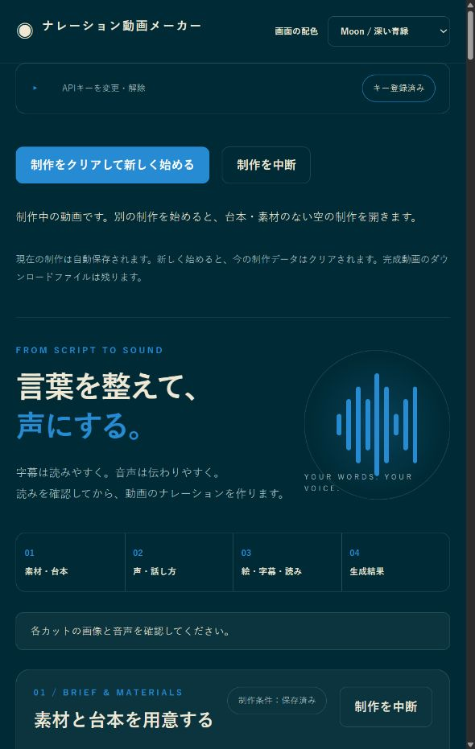
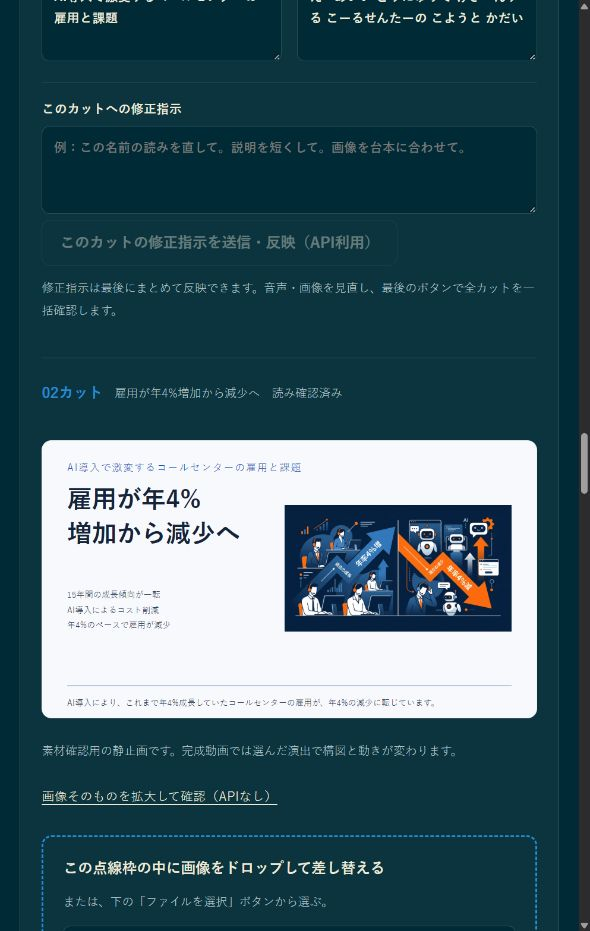

# Narrated Video Maker / ナレーション動画メーカー v1.3.0

> **Source code available; free to use.** API fees and third-party terms apply separately. / **ソースコード公開・利用無料。** API利用料と第三者の条件は別途適用されます。

Turn reference materials and scripts into 16:9 videos with Japanese narration, captions, pictures, motion and automatic BGM on Windows. / 参考資料と台本から、日本語ナレーション、字幕、画像、動き、自動BGMのある16:9動画をWindowsで作ります。

[Download the latest release / 最新版をダウンロード](https://github.com/FURUYAN1234/gemini-narration-studio/releases/latest) · [Public installation guide / 公開導入ページ](https://furuyan1234.github.io/gemini-narration-studio/)



## Requirements / 用意するもの

Use Windows 10 or 11, x64, a writable local folder, an internet connection and your own Gemini API key. ARM and macOS are unverified. / Windows 10または11のx64版、書き込み可能な保存場所、インターネット接続、ご自身のGemini APIキーを用意してください。ARM版とmacOSは動作未確認です。

The public website is a download and installation guide. Video processing runs on your PC after launching the batch file. Git, Python and a separately installed voice engine are unnecessary. / 公開サイトはダウンロードと導入案内です。動画処理はバッチで起動したPC上で行います。Git、Python、別の音声エンジンの導入は不要です。

## Download and launch / ダウンロードとバッチ起動

1. Open the latest Release above. Under Assets, choose **Source code (zip)**. / 上の最新版ダウンロードを開き、Assets欄の **Source code (zip)** をクリックします。
2. In Windows Downloads, right-click the ZIP and choose **Extract All**. Do not run files inside the ZIP. / WindowsのダウンロードでZIPを右クリックし、**すべて展開**を選びます。ZIP内のまま起動しないでください。
3. Move the extracted folder to a writable location, for example `C:\VideoTools\gemini-narration-studio-1.3.0`. Open the inner folder containing `package.json`. / 展開したフォルダーを、たとえば `C:\VideoTools\gemini-narration-studio-1.3.0` に移します。`package.json` がある内側のフォルダーを開きます。
4. Double-click **start_narration_studio.bat**. If extensions are hidden, it may appear as **start_narration_studio**, with type Windows Batch File. / **start_narration_studio.bat** をダブルクリックします。拡張子が非表示なら **start_narration_studio** と表示され、種類はWindowsバッチファイルです。
5. Keep the black terminal window open. The first launch prepares missing Node.js/npm, video libraries and the rendering browser; wait for completion. / 黒いウィンドウを開いたままにします。初回は不足するNode.js/npm、動画処理ライブラリ、描画ブラウザーを準備するので、完了まで待ちます。
6. The app opens at `http://127.0.0.1:6181/`. If the browser does not open, enter that address manually after the terminal reports READY. / `http://127.0.0.1:6181/` にアプリが開きます。開かなければ、黒いウィンドウにREADYが出た後、そのアドレスをブラウザーへ入力します。

Only obtain the ZIP from the official repository. If Windows displays a warning, verify the source and filename before deciding whether to run it; ask your administrator on managed PCs. / ZIPは公式リポジトリから取得してください。Windowsが警告を出した場合は入手元とファイル名を確認して実行を判断し、管理されたPCでは管理者へ相談してください。

Node.js is installed for the current user only when absent; the official ZIP hash is checked. The first setup needs network access and disk space, and can take several minutes. / Node.jsがなければ利用者専用フォルダーへ導入し、公式ZIPのハッシュを照合します。初回準備には通信と空き容量が必要で、数分以上かかる場合があります。

## API setup / APIキーの登録

Create or manage a key in [Google AI Studio](https://aistudio.google.com/api-keys); consult the [official key guide](https://ai.google.dev/gemini-api/docs/api-key). / [Google AI Studio](https://aistudio.google.com/api-keys)でキーを作成・確認します。操作は[Google公式のキー案内](https://ai.google.dev/gemini-api/docs/api-key)も確認してください。

Open the API section at the top, enter the key in the app and register it. Use the connection check before sending materials. A registered key alone does not prove access to every generation model. / アプリ上部のAPI欄を開き、キーを入力して登録します。素材を送信する前に接続確認を行ってください。登録済みの表示だけで全生成モデルの利用権限があるとは限りません。

The key is held only in the local server's memory, and must be entered again after that server exits. Never put it into scripts, screenshots, chat or a shared ZIP. / キーはローカルサーバーのメモリだけで保持し、サーバー終了後は再入力が必要です。台本、スクリーンショット、チャット、共有ZIPへ入れないでください。

## Make your first video / はじめての動画制作

1. Add images, PDF, UTF-8 text, audio, video, reference text or public URLs in **素材と台本を用意する**. Adding files alone does not send them to Google. / **素材と台本を用意する**で画像、PDF、UTF-8テキスト、音声、動画、参考本文や公開URLを追加します。追加だけではGoogleへ送信されません。
2. Write what to explain, or use your own script. AI script/image creation sends the selected materials and instructions to Google; generation may incur API fees. / 説明したい内容を書くか、ご自身の台本を使います。AIで台本・画像を作る操作では選んだ資料と指示をGoogleへ送り、API料金が発生する場合があります。
3. Check the resulting script, load it into the cuts and choose a voice. The 180 bundled standard voice samples can be compared without new generation. / 結果の台本を確認してカットへ読み込み、声を選びます。同梱の標準サンプル180件は新たに生成せず比較できます。
4. Check each cut's picture, displayed caption and reading. Correct names, numbers and pronunciations; replace pictures by dropping a file onto that cut. Press **全文の読みを確定** after reviewing. / 各カットの絵、表示字幕、読みを確認します。名前、数字、読み方を直し、画像はそのカットへファイルをドロップして差し替えられます。確認後に **全文の読みを確定** を押します。
5. Press **動画を作成**. Missing narration and BGM are prepared automatically, then the video is rendered locally; existing valid audio and BGM are reused. / **動画を作成** を押します。不足するナレーションとBGMを自動で用意してからPC上で動画を作り、作成済みの有効な音声とBGMは再利用します。
6. Play the completed video and check the picture, captions, pronunciation and BGM. Confirm it only after that review; MP4 and M4A are saved to Windows Downloads. / 完成動画を再生して画像、字幕、読み方、BGMを確認します。確認後に確定し、MP4とM4AはWindowsのダウンロードに保存されます。



The pictures are real app screens; their example script is for demonstrating operation, and is not independently fact-checked. Motion animates still artwork and layouts; it does not create new acting by depicted people. / 掲載画像は実際のアプリ画面です。例の台本は操作説明用で、内容の事実検証を示すものではありません。演出は静止画や配置を動かす方式で、描かれた人物の新しい演技を生成する機能ではありません。

## Captions, music and corrections / 字幕・音楽・修正

Captions use bounded, word-aware balanced lines across all templates, retaining every character. Long subtitles shrink to fit their lane. BGM is automatic and its level drops during narration. / 字幕は全テンプレートで単語を考慮した均等な行割りを使い、文字を削らず枠内へ収めます。長い字幕は文字を縮小します。BGMは自動で付き、ナレーション中に音量を下げます。

Use the optional cut-level image or script correction controls when needed. They state whether an API is used. To edit a finalized production, press **最終確定を解除して編集を再開**; this retains its assets and does not itself generate anything. / 必要なカットの画像や台本の修正欄を使います。API利用の有無は各操作に表示します。確定後の編集は **最終確定を解除して編集を再開** を押します。素材を引き継ぎ、この操作だけでは生成しません。

## Save, resume and start again / 保存・再開・新しい制作

Working data is stored in `%USERPROFILE%\GeminiNarrationStudio`; exported MP4/M4A files are in Downloads. There is no production-history menu. / 作業データは `%USERPROFILE%\GeminiNarrationStudio`、書き出したMP4/M4Aはダウンロードに保存します。制作履歴のメニューはありません。

**Normal batch launch starts a new production and clears the previous working data.** To resume your current work, open Command Prompt in the extracted folder and run the following command. Exported files in Downloads remain. / **通常のバッチ起動は新しい制作を開始し、前の作業データをクリアします。** 作業を再開したい場合は、展開フォルダーでコマンドプロンプトを開き、次を実行します。ダウンロードの書き出し済みファイルは残ります。

```bat
start_narration_studio.bat --resume
```

In PowerShell, prefix the command with ` .\`. / PowerShellでは先頭に `.\` を付け、`.\start_narration_studio.bat --resume` を実行します。

Use **制作をクリアして新しく始める** only after saving what you need. To exit, finish the current processing and press Ctrl+C in the black terminal window. / 必要なものを保存してから **制作をクリアして新しく始める** を使ってください。終了するには実行中の処理を終え、黒いウィンドウでCtrl+Cを押します。

## Troubleshooting / 困ったとき

- **No browser window:** after READY appears, open `http://127.0.0.1:6181/`. Keep the terminal open. / **画面が開かない：** READY表示後に `http://127.0.0.1:6181/` を開きます。黒いウィンドウは閉じないでください。
- **Setup stopped:** read the error in the terminal; check connection, proxy and folder write permission. Do not repeatedly run generation. / **準備が止まる：** 黒いウィンドウのエラーを確認し、接続、プロキシ、保存場所の書き込み権限を見直します。生成を何度も押さないでください。
- **API failure:** check the chosen project's billing, quota and model access. Web subscriptions do not replace the API settings. / **APIエラー：** 使用プロジェクトの課金設定、利用枠、モデルへのアクセスを確認します。Web版の契約だけでAPI設定が済むわけではありません。
- **Already running:** reuse the existing local app; if another program owns the port, check its identity before stopping it. / **起動済み：** 既存のアプリ画面を使います。別のプログラムがポートを使っている場合は、何のプログラムか確認してから終了を判断します。

## API fees and third-party software / API料金と第三者ソフトウェア

AI drafting, missing-image creation, narration and BGM creation can incur separate provider fees. File replacement, local editing, bundled sample playback and rendering with prepared assets do not generate new provider content. Failed requests are not automatically retried. / AI台本作成、不足画像の作成、ナレーション、BGMの作成では外部API料金がかかる場合があります。画像の手動差し替え、ローカル編集、同梱サンプル再生、準備済み素材の動画描画は新規の生成APIを使いません。失敗時の自動再試行はありません。

The local video renderer uses Remotion. Its license depends on your organization and use; review [Remotion licensing](https://www.remotion.dev/docs/license) and [third-party notices](THIRD_PARTY_NOTICES.md). / PC上の動画描画にはRemotionを使います。組織や利用方法によりライセンス条件が異なるため、[Remotionの条件](https://www.remotion.dev/docs/license)と[第三者の表記](THIRD_PARTY_NOTICES.md)を確認してください。

## Terms & Output Rights / 利用条件・作品の権利

The governing text is the [FURU Application Terms](LICENSE), revised 2026-10-08. / 正本は [FURU アプリ利用条件](LICENSE)（2026-10-08改定）です。

### Scope and applicability / 対象と適用範囲

These terms apply to the program, bundled prompts and accompanying documentation in versions distributed with or explicitly subject to them, only to material FURU has authority to license. These materials are the Covered Software. Third-party code, models, assets, external services, separately bundled projects and separately licensed parts retain their own terms. Merely being introduced in an article does not make something subject to these terms. / 本条件は、本条件を添付し、または配布元で適用対象として明示した版のプログラム、同梱プロンプト、付属文書のうち、FURUが許諾権限を持つ部分に適用します。以下、これらを「対象ソフトウェア」といいます。第三者のコード、モデル、素材、外部サービス、同梱の別プロジェクト、別のライセンスが明示された部分には、それぞれの条件が適用されます。紹介記事に掲載されていることだけを理由に、本条件の対象になることはありません。

This revision dated October 8, 2026 applies to distributions that include or explicitly identify this revision. It does not apply retroactively to existing release ZIPs or earlier versions. Check the LICENSE and applicable scope of the version you obtained. / 2026年10月8日改定の本条件は、この改定条件を添付または明示した配布版から適用します。既存のリリースZIPや過去版へ遡及適用しません。取得した版に添付されたLICENSEと適用範囲を確認してください。

### Use without application or permission / 申請せずにできること

You may run, copy, examine and modify the Covered Software free of charge for personal, business, internal and commissioned work. Integration into internal-only systems and connections to other tools in your own production process are also allowed. Ordinary use requires no application, prior contact or permission from FURU. / 対象ソフトウェアを、個人利用、業務利用、社内利用、受託制作のために無料で実行、複製、調査、改変できます。社内だけで使用するシステムへの組み込みや、自分の制作工程で他のツールと連携させることもできます。通常利用のための申請、事前連絡、FURUの許可は必要ありません。

Free integration into your own or another party's apps or services, and free provision to third parties, require no application, prior contact or permission from FURU outside the paid provision and bundling cases below. Preserve notices, terms and modification disclosures as described under Free sharing and introductions. Advertising revenue or voluntary donations alone do not count as paid provision. Requiring payment, purchase or membership fees to use the Covered Software or its functions does require prior permission. / 「事前に許可が必要なこと」の有料提供・有料商品への同梱等に該当しない、自社・他社のアプリや第三者向けサービスへの無料の組み込み・無料提供も、申請・事前連絡・FURUの許可は不要です。「無料の共有と解説」の表示・条件保持・改変明示の条件を守ってください。広告収益や任意の寄付があることだけでは有料提供としません。ただし、対象ソフトウェアやその機能の利用条件として料金、購入、会員費等の支払いを求める場合は、「事前に許可が必要なこと」の対象です。

You may publish, sell, monetize through advertising and deliver text, images, comics, videos and other works you create using the Covered Software as a tool. No fee, application, individual permission or credit to FURU is required for these works. External API and service fees, and the licensing or credit obligations of assets, voices and dependencies, remain separate. / 対象ソフトウェアを道具として制作した文章、画像、漫画、動画その他の成果物は、公開、販売、広告収益化、納品に利用できます。これらについて、FURUへの利用料、申請、個別許可、FURUのクレジット表記は必要ありません。外部APIや第三者サービスの料金、素材・音声・依存ソフトウェア等のライセンスやクレジット義務は別途確認してください。

### Uses requiring prior permission / 事前に許可が必要なこと

The following uses require prior permission from FURU. / 次の利用には、FURUの事前の許可が必要です。

- Selling, reselling or distributing the Covered Software or modified versions for a fee. / 対象ソフトウェアやその改変版を販売、転売、有料配布すること。

- Integrating code or functions of the Covered Software into your own or another party's paid products, paid apps or paid services for provision to third parties. Internal-only integration and tool connections within your own production process are outside this restriction. / 対象ソフトウェアのコードや機能を、自社・他社の有料商品、有料アプリ、有料サービスに組み込んで第三者へ提供すること。社内だけで使うシステムへの組み込みと、自分の制作工程でのツール連携は、この制限に含みません。

- Allowing third parties to use the Covered Software's functions through a website, API or other mechanism in exchange for payment. / 対象ソフトウェアの機能を、Webサービス、API、その他の仕組みを通じて第三者が利用できるようにし、その利用に対して料金を受け取ること。

- Providing copies or modified versions of the Covered Software as part of, an appendix to or a benefit of paid information products, teaching materials, courses, memberships or sales packages. Downloads restricted to purchasers, students or members, and benefits described as free, are included. / 対象ソフトウェアの複製や改変版を、有料の情報商材、教材、講座、会員サービス、販売パッケージの一部・付録・特典として提供すること。購入者・受講者・会員に限定したダウンロード提供や、無料の付録・特典という名目の場合も含みます。

Renaming, extracting parts, changing format or switching to download distribution does not avoid these conditions. Restrictions apply only to reproduction, adaptation and other uses of material FURU has rights to. General ideas, production techniques, independently developed implementations and uses permitted by law are not restricted. / 名称の変更、一部の抜き出し、形式の変換、ダウンロード提供への変更によって、この条件を回避することはできません。ただし、制限できる範囲は、FURUが権利を持つ部分の複製・翻案その他の利用に限られます。一般的なアイデア、制作手法、独自に開発した実装まで独占するものではなく、法令上認められる利用も制限しません。

Taking a commission, using the Covered Software yourself as a tool, and selling or delivering the completed work do not require this permission. / 利用者が制作の依頼を受け、自分で対象ソフトウェアを使い、完成した作品を販売・納品する行為には、この許可は必要ありません。

### Permission by email / メールでの問い合わせと許可

For a use requiring prior permission, contact FURU with the app concerned, intended use, recipients and whether payment is involved. / 事前許可が必要な利用を希望する場合は、対象のアプリ、利用方法、提供先、料金の有無を添えてFURUへお問い合わせください。

If FURU replies by email or another recorded method explicitly granting permission and stating its scope, you may use the software within that scope. No paper contract or seal is required. / FURUがメール等の記録の残る方法で、利用を許可する旨と対象範囲を返信した場合、その範囲で利用できます。紙の契約書や押印は必要ありません。

Sending an inquiry, receiving an automatic acknowledgment or receiving no reply does not grant permission. Consult FURU again before going beyond the permitted purpose, provision method or scope. Individually agreed terms take precedence. / 問い合わせの送信、受付の自動返信、返答がないことだけでは、許可を得たことにはなりません。許可された用途、提供形態、対象範囲を超えて利用する場合は、改めてご相談ください。個別に合意した条件がある場合は、その合意を優先します。

### Free sharing and introductions / 無料の共有と解説

Free redistribution, free integration and free provision outside the paid cases above are allowed if copyright notices, these terms and third-party licenses are retained and modifications are identified. Services that do not distribute the software must display these notices and conditions on an information page accessible to users. Do not imply that an unofficial version, product or service is official, endorsed or affiliated with FURU. / 「事前に許可が必要なこと」に該当しない無料再配布、無料の組み込み、無料提供は、著作権表示、本条件、第三者ライセンスを保持し、改変した場合は変更した旨を明示することで認めます。ソフトウェアを配布しないサービスでは、利用者が確認できる説明ページ等にこれらを表示してください。FURUの公式版、公認商品、提携サービスであると誤認させる表示はできません。

Independently authored Web articles, paid note articles, explanations, reviews, introductions and courses, whether paid or free, require no permission, prior contact or fee to FURU when copies or modified versions of the Covered Software are not included in the product. App screenshots and operation videos for introduction or explanation may be included insofar as FURU can authorize them. Ordinary links to distribution pages and lawful quotation are allowed. Check third-party rights in works or assets shown in screenshots and videos separately. / 自分で作成したWeb記事、note等の有料記事、解説、レビュー、紹介記事、講座は、有料・無料を問わず、対象ソフトウェアの複製や改変版を商品に含めなければ、FURUへの許可、事前連絡、FURUへの利用料は不要です。紹介・解説のためにFURUが権利を持つアプリの操作画面や操作動画を掲載すること、公式配布ページへの通常のリンク、法令上認められる引用も認めます。画面や動画に含まれる第三者の作品・素材等の権利は別途確認してください。

### Output rights and third-party terms / 作品の権利と第三者の条件

Using the Covered Software does not cause FURU to acquire rights in your outputs or cause these terms to apply to your outputs. / 対象ソフトウェアを利用したことを理由に、FURUが利用者の成果物の権利を取得したり、本条件を成果物に適用したりすることはありません。

If what you provide as an output includes copies or modifications of the Covered Software itself, these terms still apply to those parts. / ただし、成果物として提供するものに対象ソフトウェアそのものの複製・改変が含まれる場合、その部分には本条件が適用されます。

Whether copyright exists in an output and who owns it depend on law, creative contributions, contracts and other circumstances. FURU does not grant or guarantee clearance of third-party rights or AI service terms. / 成果物に著作権が成立するか、誰に権利が帰属するかは、法令、創作への関与、契約その他の事情によって決まります。FURUは、第三者の権利やAIサービスの条件まで許諾・保証するものではありません。

### Earlier versions and existing permissions / 過去版と既存の許諾

These terms do not revoke or narrow valid prior permissions granted under MIT, Creative Commons or other terms. Where earlier permissions remain valid for earlier versions or inherited parts, those parts may still be used under those earlier terms. / 過去にMIT、Creative Commonsその他の条件で有効に付与された許諾を、本条件によって取り消したり狭めたりすることはありません。過去版や引き継がれた部分について、従前の許諾が有効な場合は、その条件に従って利用できます。

Changes to the terms must identify the affected version and scope. An article or README update alone does not change permissions for a version obtained earlier or individually agreed permissions. / 条件を変更する場合は、対象の版と適用範囲を明示します。記事やREADMEの更新だけで、過去に取得した版の許諾や個別に合意した許可を変更することはありません。

See [previous notices and applicable scope](docs/licenses/previous-notices.md). / [以前の表示と適用範囲](docs/licenses/previous-notices.md)もご確認ください。

### Provision conditions / 提供条件

The Covered Software is provided as is. To the extent permitted by law, operation, fitness for a particular purpose, originality of outputs and non-infringement are not guaranteed. FURU is not liable for damage arising from use except where liability cannot be excluded by law. / 対象ソフトウェアは現状のまま提供します。法令で認められる範囲で、動作、特定目的への適合性、成果物の独自性や第三者権利の非侵害を保証しません。法令上免除できない責任を除き、FURUは利用に起因する損害について責任を負いません。

These are custom source-available terms. Restrictions on productization mean that they are not an open-source license under the OSI definition. / 本条件はソースコードを公開する独自の利用条件です。商品化等に制限があるため、OSIの定義によるオープンソースライセンスではありません。

---


## AI Manga Creative Suite / AIまんが制作エコシステム

This app is one component in a broader AI-assisted manga and story production workflow. / このアプリは、AIを活用した漫画・物語制作ワークフローの一部です。

| **Tool / ツール** | **Role / 役割** | **Repository / リポジトリ** |
| --- | --- | --- |
| Super FURU AI 4-koma System / Super FURU AI 4コマシステム | AI 4-panel manga generation / AI 4コマ漫画生成 | [nano-banana-pro](https://github.com/FURUYAN1234/nano-banana-pro) |
| Story Maker | Story and plot generation / 物語・プロット生成 | [story-maker](https://github.com/FURUYAN1234/story-maker) |
| AI Character Sheet Maker / AIキャラクターシートメーカー | Character reference generation / キャラクター資料生成 | [character-sheet-maker](https://github.com/FURUYAN1234/character-sheet-maker) |
| AI Comic Translation Tool / AI漫画翻訳ツール | Manga translation and regeneration / 漫画翻訳・再生成 | [comic-translation](https://github.com/FURUYAN1234/comic-translation) |
| 360° AI Panorama Generator / 360度AIパノラマ生成ツール | 360-degree background generation / 360度背景生成 | [panoforge](https://github.com/FURUYAN1234/panoforge) |
| AI Voice Comic Maker / AI音声コミックメーカー | Voice comic video generation / フルボイス動画化 | [ai-voice-comic-maker](https://github.com/FURUYAN1234/ai-voice-comic-maker) |
| Monogatari Buzz Maker / 物語バズメーカー | Trend research and creative planning / トレンド調査・創作企画 | [viral-radar](https://github.com/FURUYAN1234/viral-radar) |
| Narration Video Maker / ナレーション動画メーカー | Video generation with narration, subtitles, and BGM / ナレーション・字幕・BGM付き動画生成 | [gemini-narration-studio](https://github.com/FURUYAN1234/gemini-narration-studio) |

## Release history / 更新履歴

- **v1.3.0:** first public distribution under the new name; balanced subtitles, automatic BGM, simpler creation controls, thumbnail references and no production-history menu. / **v1.3.0：** 新名称で一般公開。字幕の行割り、自動BGM、動画作成操作、参考画像サムネイルを整理し、制作履歴メニューを撤去しました。

[Previous releases / 過去のリリース](https://github.com/FURUYAN1234/gemini-narration-studio/releases)
