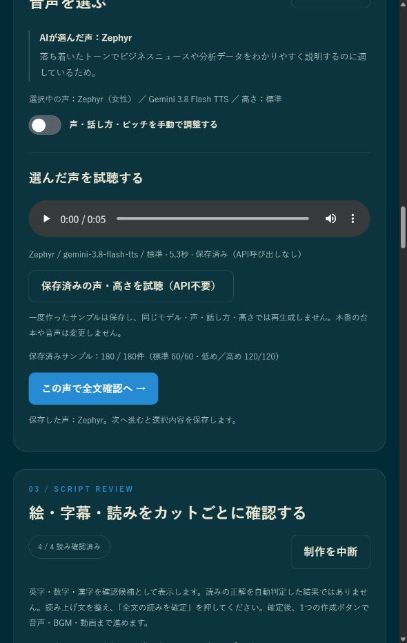

# 【アプリ無料・Windows用】ナレーション動画メーカー｜素材と台本から、声・字幕・BGM付き動画を作る

画像やメモ、参考資料はあるけれど、動画にするには台本を書き、声を録り、字幕を付け、音楽も合わせる必要がある。そこを一つの画面で進められるように、ナレーション動画メーカーを作りました。

画像や文章、PDF、公開URLなどを材料にして台本を用意し、絵と読み方を確認してから、ナレーションとBGMのある16:9動画に仕上げるWindows用アプリです。名前は旧Gemini Narration Studioから変更しました。この記事は一般公開版v1.3.0の導入手順です。

アプリ本体の利用は無料です。台本、画像、音声、BGMの生成に使う外部APIの料金は別途かかります。メンバーシップへの加入は必要ありません。

## ダウンロードと導入案内

公開ページは、アプリの紹介とダウンロード案内です。動画制作は、自分のWindows PCで付属のバッチファイルを起動して行います。

https://furuyan1234.github.io/gemini-narration-studio/

最新版の配布はこちらです。

https://github.com/FURUYAN1234/gemini-narration-studio/releases/latest

## どんな動画を作れるか

写真や図、参考文章を使った説明動画、商品の紹介、活動報告、学習用の解説などに向いています。台本の内容に合わせて声、画像、見出しや要点、画面の動きを組み合わせます。自分で用意した台本を使い、必要な絵だけ差し替えることもできます。

素材の見せ方は12種類のテンプレートから選べます。AIにタイトルや見た目を任せることもできます。画像や文字を動かす方式なので、描かれた人物が新しい演技をする動画生成とは使い道が違います。

下の画像は、実際に起動している現行アプリの画面です。掲載台本は操作例で、内容の事実確認を示すものではありません。


## まず用意するもの

Windows 10または11のx64版PC、インターネット接続、書き込み可能な保存場所、ご自身のGemini APIキーを用意してください。ARM版やmacOSは動作未確認です。

GitやPython、別の音声エンジンを自分で導入する必要はありません。Node.jsなどの実行環境がなければ、初回のバッチ起動で必要なものを準備します。初回はダウンロードがあるので、通信環境によって数分以上かかる場合があります。

## ZIPを保存して、すべて展開する

1. 上の「最新版の配布」を開きます。GitHubのRelease画面で、Assets欄にある「Source code (zip)」をクリックします。
2. Windowsの「ダウンロード」フォルダーで、保存したZIPを探します。
3. ZIPを右クリックし、「すべて展開」を選びます。ZIPの中を開いたまま起動せず、先に展開してください。
4. 展開したフォルダーを、たとえば「C:\VideoTools\gemini-narration-studio-1.3.0」のような書き込み可能な場所へ移します。
5. 展開先の中で「package.json」と「start_narration_studio.bat」が一緒に入っているフォルダーを開きます。フォルダーが二重になっている場合は内側です。

アプリは公式のGitHub配布から取得してください。Windowsに警告が出た場合は、入手元とファイル名を確認して実行を判断します。会社や学校の管理PCで制限されている場合は、管理者に相談してください。

## バッチをダブルクリックして起動する

「start_narration_studio.bat」をダブルクリックします。拡張子を表示していないPCでは「start_narration_studio」と表示され、種類は「Windows バッチ ファイル」です。

黒いウィンドウが開きます。初回は不足しているNode.js/npm、動画処理ライブラリ、描画用ブラウザーを準備します。途中で閉じず、準備完了まで待ってください。Node.jsのZIPは公式配布のハッシュと照合し、不一致なら処理を止めます。

準備が終わると、ブラウザーにアプリが開きます。自動で開かなければ、黒いウィンドウにREADYと表示されたことを確認し、ブラウザーのアドレス欄へ次を入力します。

http://127.0.0.1:6181/

これは起動したPC内のアプリのアドレスです。別の人に共有する公開リンクではありません。利用中は黒いウィンドウを開いたままにしてください。終了するときは、動画生成などの処理を終えてから黒いウィンドウでCtrl+Cを押します。

## Gemini APIキーを登録する

Google AI Studioでご自身のAPIキーを用意します。Googleアカウントでログインし、API Keysページで利用するプロジェクトを確認してキーを作成・取得してください。初めての方はGoogle側の利用条件や課金設定も確認します。

https://aistudio.google.com/api-keys

キーの作り方についてはGoogle公式の説明も参照できます。

https://ai.google.dev/gemini-api/docs/api-key

アプリ上部の「Gemini APIキーを登録」を開き、キーを入力して登録します。その後「API接続を確認（生成なし）」で確認してください。登録済みという表示だけで、すべての生成モデルを利用できることが保証されるわけではありません。

キーはローカルサーバーのメモリだけで保持し、ファイルへ保存しません。アプリのサーバーを終了・再起動した後は、再入力します。キーを台本や共有画像へ書いたり、他の人へ渡したりしないでください。

## 1本目を作る手順

1. 「素材と台本を用意する」で、画像などをドロップするかファイルを選びます。参考本文を貼り付けたり、公開URLを入れたりできます。ファイル追加だけではGoogleへ送りません。
2. どんな動画にしたいかを書き、AIに台本と画像を作ってもらいます。用意した台本がある場合は、それを編集欄へ貼り付けて使えます。AIへの送信操作では資料や指示をGoogleへ送り、API料金が発生する場合があります。
3. できた台本を確認し、台本と準備素材を読み込んで声選びへ進みます。標準の声サンプル180件を同梱しているので、サンプル比較のための新規生成は不要です。
4. 「絵・字幕・読みをカットごとに確認する」で、実画像、表示する字幕、ひらがなの読みを確認します。固有名詞や数字の読みを直したら「全文の読みを確定」を押します。
5. 「動画を作成」を押します。不足する音声とBGMを自動で用意し、その後PC上で動画を作ります。準備済みの有効な音声やBGMは再利用します。
6. 完成動画を再生し、絵、字幕、発音、音量、BGMを確認してから確定します。MP4動画とM4A音声はWindowsの「ダウンロード」へ保存されます。M4Aには動画と同じナレーションとBGMが入ります。




BGMの設定欄や独立した全文音声プレーヤーは置かず、作成と確認を分かりやすくしました。BGMは標準で付き、ナレーション中は音量を下げ、最後はフェードアウトします。字幕も、語尾だけが次行に残りにくい行割りに改めました。

## 気になるカットだけ直す

絵が合わなければ、そのカットの点線枠に画像をドロップするか、ファイルを選んで差し替えます。手動差し替えだけなら生成APIは使いません。AIで絵を作り直したい場合は、そのカットの再生成操作を使います。任意の参考画像はサムネイルで選べます。

字幕と読みの直接編集、画像の差し替え、AIへの修正指示では、処理の範囲とAPI利用が違います。各操作の表示を確認して使ってください。変えていない音声や絵を毎回全部作り直す必要はありません。

最終確定した制作を編集するときは「最終確定を解除して編集を再開」を押します。台本や素材を引き継いで編集に戻り、このボタンだけでは再生成しません。

## 保存・再開と、新しい制作

作業データは「%USERPROFILE%\GeminiNarrationStudio」に保存します。通常は「C:\Users\自分のユーザー名\GeminiNarrationStudio」です。完成したMP4とM4Aはダウンロードに保存します。

このアプリには過去の制作を選ぶ履歴メニューはありません。現在の制作を作業対象として保持します。「制作をクリアして新しく始める」を押すと前の作業データをクリアしますが、書き出してダウンロードへ保存した動画や音声は残ります。

通常のバッチ起動も新しい制作を開始します。途中の制作を再開したいときは、バッチをそのままダブルクリックする前に、次の方法を使ってください。

1. アプリを展開したフォルダーを開きます。
2. フォルダー内で右クリックし、「ターミナルで開く」を選びます。見つからない場合はエクスプローラーのアドレス欄に「cmd」と入力してEnterを押します。
3. 次のコマンドを入力してEnterを押します。

```
start_narration_studio.bat --resume
```

PowerShellが開いた場合は、先頭に「.\」を付けます。

```
.\start_narration_studio.bat --resume
```

再開した台本と素材を確認し、API処理を使う場合は画面でキーを再登録します。

## 起動や生成で困ったとき

画面が開かない場合は、黒いウィンドウが残っているか、READYが表示されているかを見ます。準備が止まった場合は、エラー文と、通信や保存場所の書き込み権限を確認してください。

APIで止まる場合はGoogle側のプロジェクト、課金設定、利用枠、モデルへのアクセスを確認します。GeminiなどのWeb版契約とAPI利用は別です。失敗した処理を自動で何度も再試行する仕組みにはしていません。

詳しい操作とトラブル対応はREADMEにまとめています。

https://github.com/FURUYAN1234/gemini-narration-studio#readme

## 利用条件と作品の扱い

個人の創作、業務、社内利用、受託制作、無料の組み込みや無料提供は、FURUへの事前申請や利用料なしで使えます。作成した作品の公開、販売、広告収益化、納品もできます。外部APIの料金や、使う素材、音声、第三者ソフトウェアの条件は別途確認してください。

アプリ自体の販売や有料配布、第三者向け有料サービスへの組み込み、有料教材などへのソフトウェアの同梱には事前許可が必要です。許可は記録に残る明確な返信で行い、問い合わせの送信や自動返信だけでは許可になりません。独自の利用条件によるソースコード公開で、OSIの定義によるオープンソースライセンスではありません。

https://github.com/FURUYAN1234/gemini-narration-studio/blob/main/LICENSE

動画の描画にはRemotionを使います。組織や利用方法によってRemotion側の条件が異なりますので、導入前に確認してください。

https://www.remotion.dev/docs/license

## 関連アプリ

漫画画像に台詞やカメラ演出を付けたい場合は、AI Voice Comic Makerも使えます。こちらは漫画画像からの動画制作を紹介した記事です。

https://note.com/happy_duck780/n/ndc6533c1512f

## 公開版の記録

2026年10月10日、v1.3.0を「ナレーション動画メーカー」として一般公開します。以前の名称はGemini Narration Studioです。今回のFURU利用条件はこの公開版から添付し、過去の配布版へ遡及適用しません。
